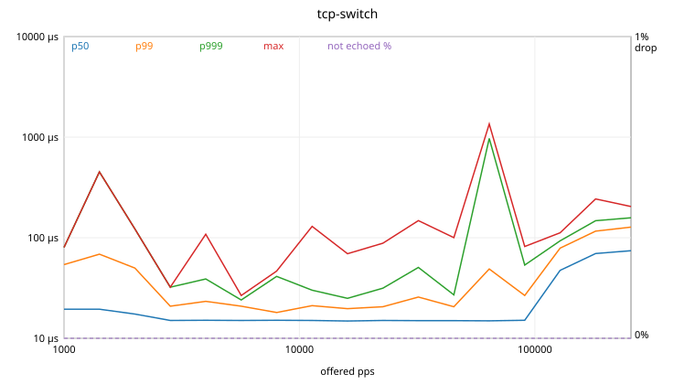

# Reading a benchmark report

Run `report.py` on the directory the sweeps wrote. It turns each sweep's JSON lines into a table and a plot, and flags the rows not to trust. This page runs it, reads a real report row by row, and explains the flags and what makes a report incomplete.

## Running report.py

```sh
python3 switch-bench/report.py RESULTS_DIR [--title T]
```

It needs only Python's standard library. Every `*.jsonl` file in `RESULTS_DIR` is one sweep, named after the file. The script writes three things into the same directory:

- `report.md`: one section per sweep, with its plot and step table, then notes defining each column,
- `results.json`: the same data in machine-readable form,
- `<sweep>.svg`: latency percentiles and the not-echoed percentage against the offered rate.

It prints `wrote RESULTS_DIR/report.md` and exits 0 when the results are complete, 1 when they are not (see [Incomplete reports](#incomplete-reports)).

A few optional files in the directory add to the report. The AWS runner writes them; for a local run they are absent and the report works without them. `expected.json` lists every sweep the run meant to produce, `source.json` records the commit, `host-setup.txt` holds the host verification output, and `<sweep>.placement.json` records which CPU every thread ran on.

## A real report

This is the TCP section of the report from one `make -C conduit docker-bench-smoke` run with the default settings, as [Running a sweep on one machine](local.md#the-smoke-run) describes. The make target wrote it with `python3 ../switch-bench/report.py ../switch-bench/out/smoke --title "Local smoke (tooling validation over net_tap; not a measurement)"`. It ran over tap devices in a Docker VM, so it is tooling validation, not a measurement. The plot and table are exactly as `report.py` wrote them:



{{#include smoke-report.md:21:39}}

Each row is one step, sorted by offered rate. Take the first row, offered 1000.

Offered pps is the rate the step asked for, summed over the workers: 1000 messages per second. Sent pps is the number of messages the generators' network stacks accepted during the measurement window, divided by the window. It counts what the generator handed to its stack, not what the NIC transmitted. Received pps counts echoes that arrived within the window, including echoes of warmup messages. Here all three are 1000.

Not echoed % is the share of measured messages that had not come back when the drain ended; messages that were due but never sent count as not echoed. Here it is 0.

The next four columns are latency: percentiles of receive time minus scheduled send time, in microseconds, over every echoed measured message. Half the messages came back within 19.5 µs, 99% within 54.0 µs. They come from one histogram merged across all workers; percentiles are never averaged. A step with no echo at all shows `-` in these columns and `NO ECHO` in the flags, and the plot marks it with an x.

Service RTT is the same round trip measured from the actual send time instead of the scheduled one, for TCP and WebSocket (UDP shows `-`). When it is close to the latency, as here (19.2 µs against 19.5 µs at the median), messages left on time and the time was spent in the network and the receiver. Send lag is how late fresh sends left: 0.2 µs at the median and 4.4 µs at the 99th percentile, well under the 20 µs that makes a step sender-late.

The two packet columns divide the packets the generators' own ports sent by the messages they sent, and the packets they received by the echoes. At 1000 messages per second both are 1.01: about one packet per message each way, plus a few others such as ACKs. [Step lines and the summary](#step-lines-and-the-summary) says what these counts include.

Further down, sent and received keep up with offered all the way to 256000 messages per second and nothing is lost. From 128000 on, the median latency rises from about 15 µs to 47.4, 69.6 and 74.2 µs, and the rows are `BUDGET-BOUND`: some messages waited because their connection already had its budget in flight, so part of that latency is the budget's. The received-packets ratio falls to 0.78, 0.31 and 0.20: fewer packets than echoes came back, so each packet carried several echoes. Send lag stays under 20 µs at the 99th percentile, so no step is sender-late and the sweep ran all 17 steps.

The UDP sweep of the same run stopped at 128000 messages per second, after 15 steps. That row is sender-late: the generators' fresh-send lag reached 68.1 µs at the 99th percentile, and the latency jumped with it:

{{#include smoke-report.md:47:48}}
{{#include smoke-report.md:63}}

`SENDER-LATE` means the generator, not the receiver, set the limit for this step. The sweep stops there, and the report counts it as incomplete.

## Flags

| Flag | Meaning |
|---|---|
| `-` | Nothing to note. |
| `SENDER-LATE` | A generator was behind schedule in this step: the 99th percentile of its fresh-send lag was above 20 µs. Fresh sends leave out messages a full or budget-bound connection owed and messages held back by a transport-wide stop ([Measuring latency under load](index.md#when-the-generator-is-the-limit)). The sweep stopped after this step. |
| `BUDGET-BOUND` | Some measured message waited because its connection already had its budget in flight (`--budget-us`). The latency in this row may be the budget's, not the receiver's. |
| `NO ECHO` | No measured message came back. |
| `CARRYOVER` | Only on junction-backend TCP and WebSocket sweeps without a budget, on steps after the first step with loss or a sender-late step. The daemon may still hold queued work from earlier steps, so these rows are not comparable with others. Budgeted sweeps are never marked. |

A sweep whose CPU placement check failed has `— INVALID` in its section heading and a list of the placement errors. Only the AWS runner records placement; [Benchmarking on AWS](aws.md#what-makes-a-sweep-invalid) explains the checks. Its measurements stay in the table and plot.

## Incomplete reports

When the results are incomplete, `report.md` starts with `# INCOMPLETE:` and a list of reasons, still followed by everything that ran, and `report.py` exits 1 and prints each reason on stderr prefixed `incomplete:`. The run above printed one:

```text
incomplete: udp-switch: sender behind schedule: worker(s) [0, 1]
```

The reasons are:

- a sweep listed in `expected.json` has no file (`<sweep>: missing`), or the directory has no sweeps at all,
- a sweep has no summary line, so it did not finish,
- a sweep's summary says it did not complete, with the coordinator's error,
- a sweep stopped because a worker was behind schedule (`<sweep>: sender behind schedule: worker(s) [<numbers>]`),
- the placement check invalidated a sweep.

The sweep's own exit status follows the same rule for one sweep: `switch-bench sweep` exits 0 only when it completed and no worker was behind schedule.

## Step lines and the summary

The report is built from the JSON lines `switch-bench sweep` prints, and `results.json` keeps them whole. Each step line has these fields:

| Field | Meaning |
|---|---|
| `offered_pps`, `sent_pps`, `received_pps`, `drop_fraction` | The rates and loss of the table's first four columns |
| `latency_ns` | p50, p99, p999 and max of receive time minus scheduled send time; `null` when nothing was echoed |
| `service_rtt_ns` | The same percentiles of echo time minus actual send time |
| `send_lag_ns` | The same percentiles of actual minus scheduled send time, over fresh sends |
| `sent`, `echoed` | Messages sent over the whole step (warmup included), and of those, how many were echoed by the end of the drain |
| `gen_tx_packets`, `gen_rx_packets` | Packets the generators' own ports sent and received from each worker's step command to the end of its drain, summed over the workers; `null` when any worker uses the junction backend |
| `budget_bound`, `generator_bound` | The `BUDGET-BOUND` and `SENDER-LATE` flags |
| `baseline_rtt_ns`, `budget_per_connection` | With `--budget-us`: the first step's median service round trip, and each worker's per-connection budget |
| `workers` | Per worker, in order: `behind_schedule`, `backlog_at_end` (messages due and not sent when sending stopped), `stops` (send batches ended by a transport-wide refusal), `last_send_ns` and `last_echo_ns` (time of its last send and last echo, after its step start) |

The packet counts are read when a worker receives the step and after its drain, never inside the measurement window: on ENA each read is an admin command that sleeps at least 100 µs. They count every packet on the generator's port, including ACKs, ARP and retransmissions, and say nothing about the receiver's NIC.

The last line is the summary: `steps`, `complete`, `generator_bound`, `behind_workers` (the workers behind schedule at the step that stopped the sweep) and `error`.

## Where to go next

[Benchmarking on AWS](aws.md) produces reports like this on real ENA hardware, with the placement checks filled in.
