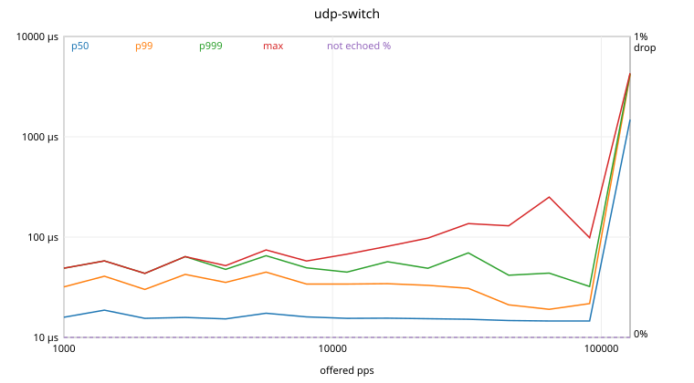

# INCOMPLETE: Local smoke (tooling validation over net_tap; not a measurement)

These results are incomplete; what ran is below.

- udp-switch: sender behind schedule: worker(s) [0, 1]

Packet counts are the generator NICs' (each generator's own port, read when it gets the step and after its drain, over the same span as messages sent and echoed), not the receiver's: gen tx packets per sent message is packets put on the wire per message; gen rx packets per echo counts echo and ACK packets per echoed message. Junction packet counts are unavailable (-); conduit counters do not describe junction traffic.

## overload-check

| offered pps | sent pps | received pps | not echoed % | p50 µs | p99 µs | p99.9 µs | max µs | service RTT p50 µs | service RTT p99 µs | send lag p50 µs | send lag p99 µs | gen tx packets per sent message | gen rx packets per echo | flags |
|---:|---:|---:|---:|---:|---:|---:|---:|---:|---:|---:|---:|---:|---:|---|
| 64000 | 0 | 0 | 100.000 | - | - | - | - | - | - | - | - | 0.07 | - | NO ECHO |

## tcp-switch

| offered pps | sent pps | received pps | not echoed % | p50 µs | p99 µs | p99.9 µs | max µs | service RTT p50 µs | service RTT p99 µs | send lag p50 µs | send lag p99 µs | gen tx packets per sent message | gen rx packets per echo | flags |
|---:|---:|---:|---:|---:|---:|---:|---:|---:|---:|---:|---:|---:|---:|---|
| 1000 | 1000 | 1000 | 0.000 | 19.5 | 54.0 | 80.1 | 80.1 | 19.2 | 53.0 | 0.2 | 4.4 | 1.01 | 1.01 | - |
| 1414 | 1413 | 1413 | 0.000 | 19.5 | 68.6 | 451.6 | 451.6 | 19.2 | 68.1 | 0.2 | 3.8 | 1.01 | 1.01 | - |
| 2000 | 2000 | 2000 | 0.000 | 17.4 | 49.9 | 122.4 | 122.4 | 17.5 | 54.0 | 0.2 | 1.7 | 1.00 | 1.00 | - |
| 2828 | 2827 | 2827 | 0.000 | 15.0 | 20.9 | 32.2 | 32.2 | 15.0 | 23.9 | 0.1 | 0.2 | 1.00 | 1.00 | - |
| 4000 | 4000 | 4000 | 0.000 | 15.1 | 23.3 | 38.9 | 108.3 | 15.0 | 24.6 | 0.1 | 0.2 | 1.00 | 1.00 | - |
| 5657 | 5660 | 5660 | 0.000 | 15.0 | 20.9 | 24.1 | 26.7 | 14.9 | 20.9 | 0.1 | 0.2 | 1.00 | 1.00 | - |
| 8000 | 8000 | 8000 | 0.000 | 15.1 | 18.0 | 41.2 | 46.6 | 15.0 | 16.8 | 0.1 | 0.2 | 1.00 | 1.00 | - |
| 11314 | 11313 | 11313 | 0.000 | 15.0 | 21.1 | 30.1 | 129.7 | 14.8 | 20.7 | 0.1 | 0.2 | 1.00 | 1.00 | - |
| 16000 | 16000 | 16000 | 0.000 | 14.8 | 19.7 | 25.0 | 69.4 | 14.7 | 19.6 | 0.1 | 0.2 | 1.00 | 1.00 | - |
| 22627 | 22627 | 22627 | 0.000 | 15.0 | 20.6 | 31.5 | 88.1 | 14.8 | 20.4 | 0.1 | 0.2 | 1.00 | 1.00 | - |
| 32000 | 32000 | 32000 | 0.000 | 15.0 | 25.7 | 50.7 | 147.9 | 14.8 | 25.6 | 0.1 | 0.2 | 1.00 | 1.00 | BUDGET-BOUND |
| 45255 | 45257 | 45253 | 0.000 | 15.0 | 20.6 | 27.0 | 100.2 | 14.8 | 20.2 | 0.1 | 0.2 | 1.00 | 1.00 | - |
| 64000 | 64000 | 64000 | 0.000 | 14.9 | 48.9 | 970.8 | 1352.6 | 14.8 | 31.1 | 0.1 | 0.5 | 1.00 | 1.00 | BUDGET-BOUND |
| 90510 | 90510 | 90513 | 0.000 | 15.1 | 26.6 | 53.5 | 81.8 | 15.0 | 26.2 | 0.1 | 3.2 | 1.00 | 1.00 | - |
| 128000 | 128000 | 127997 | 0.000 | 47.4 | 78.8 | 93.2 | 111.9 | 46.6 | 77.3 | 0.2 | 13.8 | 1.00 | 0.78 | BUDGET-BOUND |
| 181020 | 181020 | 181053 | 0.000 | 69.6 | 116.2 | 147.5 | 243.1 | 67.6 | 107.0 | 0.2 | 12.9 | 0.96 | 0.31 | BUDGET-BOUND |
| 256000 | 255983 | 255980 | 0.000 | 74.2 | 127.5 | 157.7 | 204.0 | 69.6 | 88.6 | 0.2 | 10.9 | 0.75 | 0.20 | BUDGET-BOUND |

BUDGET-BOUND: some messages waited because their connection already had its budget in flight (rate share x (baseline RTT + window)): the latency there may be the budget's, not receiver saturation.

## udp-switch

| offered pps | sent pps | received pps | not echoed % | p50 µs | p99 µs | p99.9 µs | max µs | service RTT p50 µs | service RTT p99 µs | send lag p50 µs | send lag p99 µs | gen tx packets per sent message | gen rx packets per echo | flags |
|---:|---:|---:|---:|---:|---:|---:|---:|---:|---:|---:|---:|---:|---:|---|
| 1000 | 1000 | 1000 | 0.000 | 14.7 | 24.2 | 27.6 | 27.6 | - | - | 0.1 | 0.3 | 1.00 | 1.01 | - |
| 1414 | 1413 | 1413 | 0.000 | 14.8 | 37.4 | 343.4 | 343.4 | - | - | 0.1 | 1.6 | 1.00 | 1.00 | - |
| 2000 | 2000 | 2000 | 0.000 | 14.6 | 18.7 | 25.1 | 25.1 | - | - | 0.1 | 0.2 | 1.00 | 1.00 | - |
| 2828 | 2827 | 2827 | 0.000 | 14.7 | 22.9 | 28.9 | 28.9 | - | - | 0.1 | 0.9 | 1.00 | 1.00 | - |
| 4000 | 4000 | 4000 | 0.000 | 14.6 | 17.8 | 21.2 | 21.8 | - | - | 0.1 | 0.2 | 1.00 | 1.00 | - |
| 5657 | 5660 | 5660 | 0.000 | 14.7 | 21.1 | 56.1 | 99.8 | - | - | 0.1 | 0.7 | 1.00 | 1.00 | - |
| 8000 | 8000 | 8000 | 0.000 | 14.5 | 14.9 | 21.4 | 22.0 | - | - | 0.1 | 0.2 | 1.00 | 1.00 | - |
| 11314 | 11313 | 11313 | 0.000 | 14.6 | 20.4 | 33.5 | 63.3 | - | - | 0.1 | 0.2 | 1.00 | 1.00 | - |
| 16000 | 16000 | 16000 | 0.000 | 14.7 | 22.3 | 54.5 | 143.4 | - | - | 0.1 | 0.2 | 1.00 | 1.00 | - |
| 22627 | 22627 | 22627 | 0.000 | 14.7 | 26.2 | 101.4 | 197.3 | - | - | 0.1 | 0.2 | 1.00 | 1.00 | - |
| 32000 | 32000 | 32000 | 0.000 | 14.6 | 75.8 | 2359.3 | 2624.0 | - | - | 0.1 | 0.2 | 1.00 | 1.00 | - |
| 45255 | 45257 | 45253 | 0.000 | 14.7 | 27.6 | 127.0 | 184.3 | - | - | 0.1 | 0.3 | 1.00 | 1.00 | - |
| 64000 | 64000 | 64000 | 0.000 | 14.6 | 20.9 | 42.8 | 198.0 | - | - | 0.1 | 2.9 | 1.00 | 1.00 | - |
| 90510 | 90507 | 90513 | 0.000 | 14.7 | 26.5 | 50.2 | 123.9 | - | - | 0.1 | 3.6 | 1.00 | 1.00 | - |
| 128000 | 128000 | 127957 | 0.000 | 385.0 | 3014.7 | 3129.3 | 3204.4 | - | - | 0.1 | 68.1 | 1.00 | 1.00 | SENDER-LATE |

SENDER-LATE: a sender's fresh sends fell behind schedule (send lag p99 over 20 µs, not counting messages a full connection owed or a pool stop held back) and the sweep stopped.

## ws-switch

| offered pps | sent pps | received pps | not echoed % | p50 µs | p99 µs | p99.9 µs | max µs | service RTT p50 µs | service RTT p99 µs | send lag p50 µs | send lag p99 µs | gen tx packets per sent message | gen rx packets per echo | flags |
|---:|---:|---:|---:|---:|---:|---:|---:|---:|---:|---:|---:|---:|---:|---|
| 1000 | 1000 | 1000 | 0.000 | 15.4 | 32.5 | 60.0 | 60.0 | 15.3 | 32.1 | 0.2 | 0.6 | 1.02 | 1.01 | - |
| 1414 | 1413 | 1413 | 0.000 | 15.3 | 21.5 | 29.0 | 29.0 | 15.1 | 23.7 | 0.2 | 0.3 | 1.01 | 1.00 | - |
| 2000 | 2000 | 2000 | 0.000 | 15.3 | 21.9 | 106.5 | 106.5 | 15.1 | 22.1 | 0.2 | 0.4 | 1.00 | 1.00 | - |
| 2828 | 2827 | 2827 | 0.000 | 15.2 | 21.9 | 126.3 | 126.3 | 15.0 | 21.4 | 0.2 | 0.9 | 1.00 | 1.00 | - |
| 4000 | 4000 | 4000 | 0.000 | 15.1 | 18.2 | 21.6 | 37.1 | 15.0 | 18.4 | 0.2 | 0.2 | 1.00 | 1.00 | - |
| 5657 | 5660 | 5660 | 0.000 | 15.0 | 20.6 | 26.8 | 30.3 | 14.9 | 20.5 | 0.2 | 0.2 | 1.00 | 1.00 | - |
| 8000 | 8000 | 8000 | 0.000 | 15.1 | 21.2 | 40.7 | 49.6 | 15.0 | 21.0 | 0.2 | 0.6 | 1.00 | 1.00 | - |
| 11314 | 11313 | 11313 | 0.000 | 15.2 | 22.4 | 53.8 | 114.3 | 15.0 | 21.8 | 0.2 | 0.3 | 1.00 | 1.00 | - |
| 16000 | 16000 | 16000 | 0.000 | 15.1 | 16.6 | 28.4 | 36.9 | 15.0 | 16.6 | 0.2 | 0.2 | 1.00 | 1.00 | - |
| 22627 | 22627 | 22623 | 0.000 | 15.0 | 40.4 | 78.8 | 180.6 | 15.0 | 37.9 | 0.2 | 0.5 | 1.00 | 1.00 | - |
| 32000 | 32000 | 32000 | 0.000 | 15.1 | 16.5 | 21.9 | 26.5 | 15.0 | 16.4 | 0.1 | 0.2 | 1.00 | 1.00 | - |
| 45255 | 45257 | 45253 | 0.000 | 15.3 | 22.0 | 86.5 | 171.2 | 15.2 | 21.6 | 0.2 | 0.3 | 1.00 | 1.00 | BUDGET-BOUND |
| 64000 | 64000 | 64000 | 0.000 | 15.1 | 20.4 | 23.2 | 54.2 | 14.9 | 20.2 | 0.2 | 0.2 | 1.00 | 1.00 | - |
| 90510 | 90507 | 90513 | 0.000 | 15.2 | 38.9 | 89.6 | 201.0 | 15.0 | 35.1 | 0.2 | 3.6 | 1.00 | 1.00 | BUDGET-BOUND |
| 128000 | 128000 | 127997 | 0.000 | 47.1 | 78.3 | 94.7 | 127.8 | 46.3 | 77.8 | 0.2 | 13.1 | 1.00 | 0.78 | BUDGET-BOUND |
| 181020 | 181027 | 181030 | 0.002 | 60.9 | 98.3 | 195.6 | 292.9 | 57.6 | 78.3 | 0.2 | 12.4 | 0.91 | 0.35 | BUDGET-BOUND |
| 256000 | 256010 | 256020 | 0.000 | 76.8 | 124.9 | 139.3 | 167.2 | 71.2 | 87.6 | 0.2 | 10.4 | 0.72 | 0.20 | BUDGET-BOUND |

BUDGET-BOUND: some messages waited because their connection already had its budget in flight (rate share x (baseline RTT + window)): the latency there may be the budget's, not receiver saturation.

Notes: latency is receive time minus scheduled send time (open loop, no coordinated omission); not echoed % is measured messages not echoed by the end of the drain, never-sent ones included (sending stops at the end of the window); sent pps counts messages accepted by the generator stack, not NIC transmissions; received pps counts echoes arriving within the window, including warmup echoes; baseline RTT is the first step's median echo time minus actual send time (TCP/ws); no TLS (ws:// only).
