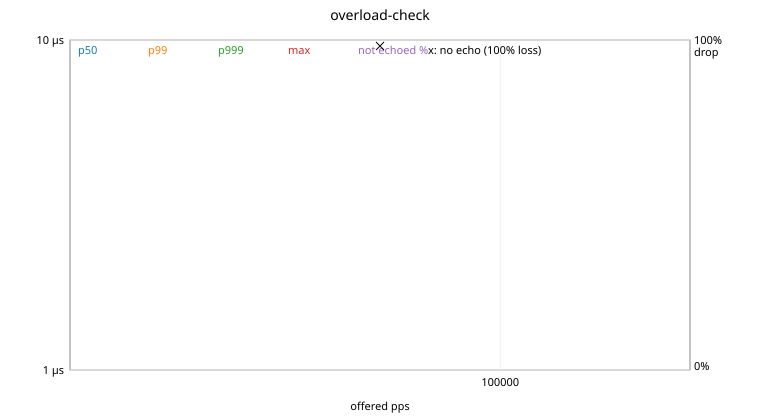
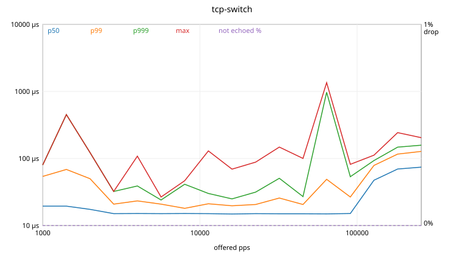
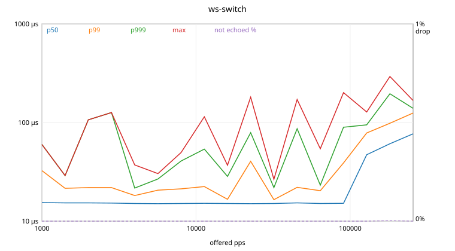

# INCOMPLETE: Local smoke (tooling validation over net_tap; not a measurement)

These results are incomplete; what ran is below.

- overload-check: sender fell behind schedule; receiver capacity is not isolated
- tcp-switch: sender fell behind schedule; receiver capacity is not isolated
- udp-switch: sender fell behind schedule; receiver capacity is not isolated
- ws-switch: sender fell behind schedule; receiver capacity is not isolated

## overload-check

| offered pps | sent pps | received pps | not echoed % | p50 µs | p99 µs | p99.9 µs | max µs | flags |
|---:|---:|---:|---:|---:|---:|---:|---:|---|
| 64000 | 0 | 0 | 100.000 | - | - | - | - | SENDER-LATE NO ECHO |

SENDER-LATE: a sender fell behind schedule and the sweep stopped. This does not identify the cause; receiver backpressure can also delay sends.

## tcp-switch

| offered pps | sent pps | received pps | not echoed % | p50 µs | p99 µs | p99.9 µs | max µs | flags |
|---:|---:|---:|---:|---:|---:|---:|---:|---|
| 1000 | 1000 | 1000 | 0.000 | 15.3 | 19.1 | 22.9 | 22.9 | - |
| 1414 | 1413 | 1413 | 0.000 | 15.8 | 52.0 | 90.4 | 90.4 | - |
| 2000 | 2000 | 2000 | 0.000 | 15.6 | 33.8 | 43.8 | 43.8 | - |
| 2828 | 2827 | 2827 | 0.000 | 15.4 | 21.1 | 34.1 | 34.1 | - |
| 4000 | 4000 | 4000 | 0.000 | 15.2 | 16.8 | 23.0 | 25.8 | - |
| 5657 | 5660 | 5660 | 0.000 | 15.2 | 21.1 | 27.6 | 28.0 | - |
| 8000 | 8000 | 8000 | 0.000 | 15.1 | 19.1 | 32.8 | 72.8 | - |
| 11314 | 11313 | 11313 | 0.000 | 15.2 | 21.0 | 25.6 | 36.6 | - |
| 16000 | 16000 | 16000 | 0.000 | 15.1 | 27.9 | 43.8 | 210.4 | - |
| 22627 | 22627 | 22627 | 0.000 | 15.2 | 20.7 | 34.3 | 68.5 | - |
| 32000 | 32000 | 32000 | 0.000 | 15.1 | 27.8 | 103.4 | 182.8 | BUDGET-BOUND |
| 45255 | 45257 | 45253 | 0.000 | 15.1 | 20.6 | 30.5 | 50.1 | - |
| 64000 | 64000 | 64000 | 0.000 | 15.0 | 22.7 | 137.2 | 226.6 | BUDGET-BOUND |
| 90510 | 90507 | 90513 | 0.000 | 15.3 | 21.8 | 43.3 | 74.1 | - |
| 128000 | 127990 | 127977 | 0.003 | 81.4 | 148.5 | 225.3 | 291.2 | SENDER-LATE BUDGET-BOUND |

SENDER-LATE: a sender fell behind schedule and the sweep stopped. This does not identify the cause; receiver backpressure can also delay sends.

BUDGET-BOUND: some messages waited because their connection already had its budget in flight (rate share x (baseline RTT + window)): the latency there may be the budget's, not receiver saturation.

## udp-switch

| offered pps | sent pps | received pps | not echoed % | p50 µs | p99 µs | p99.9 µs | max µs | flags |
|---:|---:|---:|---:|---:|---:|---:|---:|---|
| 1000 | 1000 | 1000 | 0.000 | 15.9 | 31.9 | 49.0 | 49.0 | - |
| 1414 | 1413 | 1413 | 0.000 | 18.7 | 40.7 | 57.9 | 57.9 | - |
| 2000 | 2000 | 2000 | 0.000 | 15.5 | 30.1 | 43.5 | 43.5 | - |
| 2828 | 2827 | 2827 | 0.000 | 15.8 | 42.5 | 63.9 | 63.9 | - |
| 4000 | 4000 | 4000 | 0.000 | 15.3 | 35.3 | 47.6 | 52.0 | - |
| 5657 | 5660 | 5660 | 0.000 | 17.4 | 44.8 | 65.3 | 74.4 | - |
| 8000 | 8000 | 8000 | 0.000 | 16.0 | 34.0 | 49.4 | 57.8 | - |
| 11314 | 11313 | 11313 | 0.000 | 15.5 | 34.0 | 44.8 | 67.6 | - |
| 16000 | 16000 | 16000 | 0.000 | 15.6 | 34.3 | 56.8 | 80.9 | - |
| 22627 | 22627 | 22627 | 0.000 | 15.4 | 33.0 | 48.9 | 97.7 | - |
| 32000 | 32000 | 32000 | 0.000 | 15.2 | 30.8 | 69.6 | 136.3 | - |
| 45255 | 45257 | 45253 | 0.000 | 14.7 | 21.1 | 41.7 | 129.5 | - |
| 64000 | 64000 | 64000 | 0.000 | 14.6 | 19.1 | 43.8 | 250.7 | - |
| 90510 | 90510 | 90513 | 0.000 | 14.6 | 21.8 | 32.1 | 98.6 | - |
| 128000 | 128007 | 129407 | 0.000 | 1482.8 | 4145.2 | 4259.8 | 4305.9 | SENDER-LATE |

SENDER-LATE: a sender fell behind schedule and the sweep stopped. This does not identify the cause; receiver backpressure can also delay sends.

## ws-switch

| offered pps | sent pps | received pps | not echoed % | p50 µs | p99 µs | p99.9 µs | max µs | flags |
|---:|---:|---:|---:|---:|---:|---:|---:|---|
| 1000 | 1000 | 1000 | 0.000 | 15.6 | 27.1 | 39.8 | 39.8 | - |
| 1414 | 1413 | 1413 | 0.000 | 15.5 | 26.6 | 88.4 | 88.4 | - |
| 2000 | 2000 | 2000 | 0.000 | 15.5 | 31.6 | 105.9 | 105.9 | - |
| 2828 | 2827 | 2827 | 0.000 | 15.5 | 21.4 | 28.5 | 28.5 | - |
| 4000 | 4000 | 4000 | 0.000 | 15.7 | 37.4 | 78.3 | 134.8 | - |
| 5657 | 5660 | 5660 | 0.000 | 15.5 | 21.8 | 37.6 | 85.7 | - |
| 8000 | 8000 | 8000 | 0.000 | 15.4 | 26.8 | 51.7 | 67.2 | - |
| 11314 | 11313 | 11313 | 0.000 | 15.3 | 21.0 | 31.0 | 39.4 | - |
| 16000 | 16000 | 16000 | 0.000 | 15.4 | 27.0 | 44.8 | 161.0 | - |
| 22627 | 22627 | 22623 | 0.000 | 15.3 | 20.9 | 85.0 | 307.1 | BUDGET-BOUND |
| 32000 | 32000 | 32000 | 0.000 | 15.2 | 426.0 | 2375.7 | 2565.4 | BUDGET-BOUND |
| 45255 | 45257 | 45253 | 0.000 | 15.4 | 21.1 | 33.0 | 106.7 | BUDGET-BOUND |
| 64000 | 64000 | 64000 | 0.000 | 15.2 | 21.4 | 29.3 | 68.7 | - |
| 90510 | 90507 | 90513 | 0.000 | 15.6 | 39.4 | 220.2 | 272.8 | BUDGET-BOUND |
| 128000 | 128000 | 128007 | 0.000 | 86.0 | 139.3 | 288.8 | 365.1 | SENDER-LATE BUDGET-BOUND |

SENDER-LATE: a sender fell behind schedule and the sweep stopped. This does not identify the cause; receiver backpressure can also delay sends.

BUDGET-BOUND: some messages waited because their connection already had its budget in flight (rate share x (baseline RTT + window)): the latency there may be the budget's, not receiver saturation.

Notes: latency is receive time minus scheduled send time (open loop, no coordinated omission); not echoed % is measured messages not echoed by the end of the drain, never-sent ones included (sending stops at the end of the window); sent pps counts messages accepted by the generator stack, not NIC transmissions; received pps counts echoes arriving within the window, including warmup echoes; baseline RTT is the first step's median echo time minus actual send time (TCP/ws); no TLS (ws:// only).
